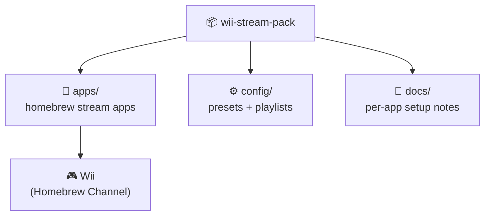

# wii-stream-pack

> **Streaming on the Wii, packed up.** A curated stream pack for the Nintendo Wii — streaming sources and media tooling collected into one installable pack.

## Why you should care

The Wii is still a beloved media box, but its streaming options are scattered across forums, dead links, and half-remembered homebrew apps. **wii-stream-pack** aims to fix that: one pack, one install, every working stream source in one place — so the console under your TV becomes a proper streamer again.

## Status

🚧 **Pre-implementation.** This repository currently contains only this README. The pack contents — app list, install layout, and any launcher/config — are pending. What follows is the intended shape, not shipped content.

## Intended shape

- **Curated, not exhaustive** — only sources that actually work on real hardware make the cut.
- **One layout** — predictable `apps/` + `config/` structure so the pack is installable as a unit.
- **Documented** — every included source gets a setup note; no mystery binaries.

## Roadmap

- [ ] Define the pack manifest (what's in, versions, sources)
- [ ] `apps/` layout for Homebrew Channel installs
- [ ] `config/` presets and playlists
- [ ] Per-app setup docs
- [ ] Install/verify script

## Contributing

Suggest a working Wii stream source via issue, or PR the pack layout once it exists. Until the first content lands, discussion in issues is the most useful contribution.

## License & security

No license file has been declared yet — all rights reserved by default until one is added. Note: stream sources are third-party services with their own terms; only include and use sources you're entitled to. Nothing here will ever ask for credentials it doesn't need.
